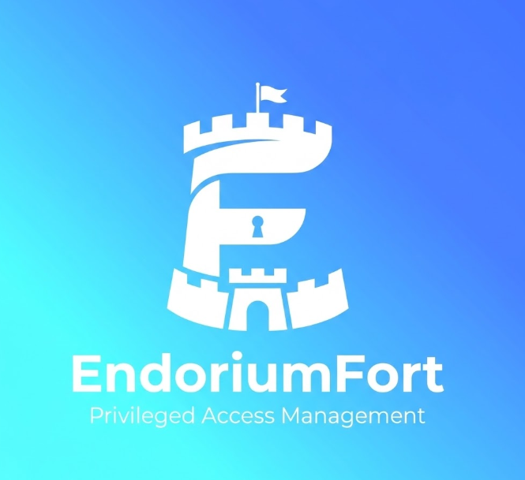
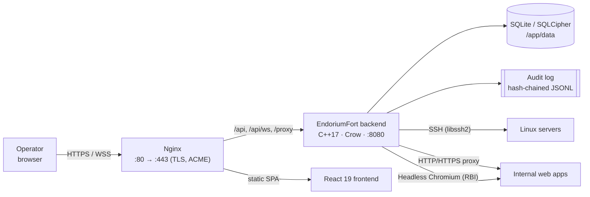

<div align="center">



# EndoriumFort — Community Edition

### Self-hosted Privileged Access Management bastion

**One gateway for your admin access, with a full audit trail.**
<br>
SSH in the browser · isolated web access · credential vault · MFA & passkeys · tamper-evident audit

<br>

<a href="https://github.com/Endorium-Group/EndoriumFort-CE/releases"></a>
<a href="https://github.com/Endorium-Group/EndoriumFort-CE/actions/workflows/ci.yml"></a>
<a href="https://github.com/Endorium-Group/EndoriumFort-CE/actions/workflows/codeql.yml"></a>
<a href="LICENSE"></a>


<br><br>

[**Quick start**](#quick-start) ·
[**Features**](#features) ·
[**Editions**](#community-vs-enterprise) ·
[**Configuration**](#configuration) ·
[**Development**](#development) ·
[**API**](#api-overview) ·
[**Docs**](docs/index.md)

</div>

---

## What is EndoriumFort?

EndoriumFort is a **sovereign, self-hosted PAM bastion**. Operators sign in once,
then reach their servers and internal web applications **through** the bastion.
Credentials stay on the server side and every action is recorded in the audit trail.

- **Single-tenant and self-hosted.** Runs on your own hardware and works air-gapped.
- **Credentials never reach the operator.** Secrets are injected server-side and encrypted at rest.
- **Tamper-evident audit.** Audit lines are hash-chained (optionally HMAC-keyed) and can be verified through the API.
- **Lightweight.** One C++ binary, one SQLite file and an Nginx front end.

> [!NOTE]
> This repository is the **Community Edition (CE)**. EndoriumFort follows an
> [open-core model](docs/OPEN-CORE.md): Enterprise features are **not present in
> this code base**, and their routes return `404` in CE builds.
> See [Community vs Enterprise](#community-vs-enterprise).

---

## Features

<table>
<tr>
<td width="50%" valign="top">

### Access
- **Web SSH terminal**: full xterm.js terminal over WebSocket, with credentials injected server-side
- **HTTP/HTTPS reverse proxy**: open internal web apps through `/proxy/<id>` with cookie-based auth and no tokens in URLs
- **Remote Browser Isolation (RBI)**: a throwaway headless Chromium runs server-side and only pixels are streamed to the operator (Linux)
- **Session shadowing**: read-only live view of active SSH sessions
- **Access-first workspace**: open a resource and work with it without leaving the page

</td>
<td width="50%" valign="top">

### Identity & authentication
- **scrypt** password hashing, with transparent migration of legacy hashes
- **TOTP 2FA** (RFC 6238) with QR code enrolment
- **WebAuthn / passkeys**
- Configurable MFA policy (`all` / `admins` / `none`), password length & history
- Idle and absolute session timeouts, `HttpOnly` + `SameSite=Strict` cookies
- Brute-force protection per user and per IP, with exponential back-off

</td>
</tr>
<tr>
<td valign="top">

### Secrets & data protection
- **Credential vault**: AES-256-GCM encryption at rest, with key rotation through `ENDORIUMFORT_VAULT_KEY_OLD`
- **Ephemeral credentials**: one-time credential leases per resource
- **Database encryption**: the whole SQLite file is encrypted when the binary is built against **SQLCipher**
- **Per-user data export** (GDPR)

</td>
<td valign="top">

### Governance & audit
- Role baseline + per-user **resource scope** + per-resource **access policy**
- **Session risk preview** before access is opened
- **Hash-chained audit log** (`/api/audit/verify`), with configurable rotation and retention
- Live **dashboard KPIs** and a session stream
- Hardened security headers (CSP, HSTS behind TLS, COOP/CORP, …)

</td>
</tr>
</table>

---

## Community vs Enterprise

| Capability | CE | EE |
|---|:---:|:---:|
| Web SSH terminal, session shadowing | ✅ | ✅ |
| HTTP/HTTPS proxy & Remote Browser Isolation | ✅ | ✅ |
| Credential vault, ephemeral credentials | ✅ | ✅ |
| TOTP, WebAuthn/passkeys, MFA policy | ✅ | ✅ |
| Hash-chained audit, dashboard, risk preview | ✅ | ✅ |
| Signed offline licence support (`/api/license/*`) | ✅ | ✅ |
| RDP & VNC in the browser | — | ✅ |
| Session recording replay, Session DNA, evidence packs | — | ✅ |
| JIT access requests, dual approval, access governance | — | ✅ |
| SSO (OIDC/SAML), LDAP directory admin, SCIM, SIEM/ITSM | — | ✅ |
| Security Center (incidents, containment, alerts) | — | ✅ |
| Relays, Cluster / HA, agent tunnelling | — | ✅ |

In CE the premium code is **absent at build time**: `backend/src/pro_stub.cc` and
`frontend/src/pro-stub/` take its place. The full breakdown is in
[docs/OPEN-CORE.md](docs/OPEN-CORE.md).

---

## Architecture



```text
EndoriumFort-CE/
├── backend/           C++17 API server (Crow, Asio, libssh2, OpenSSL, SQLite/SQLCipher)
│   ├── src/           routes, auth/MFA, vault, SSH, HTTP proxy, RBI, licence, pro_stub.cc
│   ├── tests/         CTest suites
│   └── tools/         RBI CEF helper
├── frontend/          React 19 + Vite 8 SPA (xterm.js, i18n EN/FR)
├── docker/            entrypoint.sh, nginx.conf
├── deploy/helm/       Helm chart (OCI on GHCR)
├── packaging/deb/     systemd unit, nginx site, maintainer scripts
├── scripts/           .deb builder, APT GPG helper, DB reset
├── docs/              open-core design, admin console guide
├── Dockerfile         multi-stage build (EDITION=community|enterprise)
└── docker-compose*.yml, run-dev.sh, run-prod.sh, build-all.sh/.ps1
```

---

## Quick start

### Option 1: Docker (recommended)

The Community image is published to GHCR (and Docker Hub) with the `community`
tag and versioned `<version>-ce` tags.

```bash
docker run -d --name endoriumfort \
  -p 80:80 -p 443:443 \
  -v ef-data:/app/data -v ef-recordings:/app/recordings \
  ghcr.io/endorium-group/endoriumfort:community

# Get the one-time admin password (printed once on first boot)
docker logs endoriumfort 2>&1 | grep -A2 "one-time"
```

Then open **https://localhost**. The bundled certificate is self-signed; set
`ACME_ENABLED=1` to get a Let's Encrypt certificate.

<details>
<summary><b>Docker Compose (dev & production profiles)</b></summary>

```bash
git clone https://github.com/Endorium-Group/EndoriumFort-CE.git
cd EndoriumFort-CE

# Simple profile (defaults to ghcr.io/endorium-group/endoriumfort:community)
docker compose up -d

# Hardened production profile (no-new-privileges, resource limits, log rotation)
cp .env.prod.example .env.prod      # pin DOCKER_TAG (<version>-ce), set domain, WebAuthn, ACME
./run-prod.sh start                 # start | stop | restart | logs | status | pull | update | config
```

> `docker-compose.prod.yml` joins an external `edge` network. Create it once with
> `docker network create edge`.

To build the Community image locally (`docker compose build` already passes `EDITION=community`):

```bash
docker build --build-arg EDITION=community -t endoriumfort-ce .
```

`RBI_ENGINE=cdp` (default) or `cef` selects the browser-isolation helper baked into the image.

</details>

### Option 2: Debian / Ubuntu package

```bash
curl -fsSL https://endorium-group.github.io/EndoriumFort-CE/endoriumfort-archive-keyring.asc \
  | sudo gpg --dearmor -o /usr/share/keyrings/endoriumfort.gpg
echo "deb [signed-by=/usr/share/keyrings/endoriumfort.gpg] https://endorium-group.github.io/EndoriumFort-CE stable main" \
  | sudo tee /etc/apt/sources.list.d/endoriumfort.list
sudo apt-get update && sudo apt-get install endoriumfort-server
```

This installs a hardened `endoriumfort` systemd service, configured through
`/etc/endoriumfort/endoriumfort.env`, plus an Nginx site. The `.deb` is also
attached to every [GitHub release](https://github.com/Endorium-Group/EndoriumFort-CE/releases).

### Option 3: Kubernetes (Helm)

```bash
helm install ef oci://ghcr.io/endorium-group/charts/endoriumfort \
  --version <X.Y.Z> \
  --namespace endoriumfort --create-namespace \
  --set ingress.enabled=true \
  --set ingress.hosts[0].host=pam.example.com \
  --set config.webauthn.rpId=pam.example.com \
  --set config.webauthn.origin=https://pam.example.com \
  --set secrets.vaultKey=$(openssl rand -hex 32)
```

The chart deploys a single replica on purpose, because SQLite has one writer.
k3s and Traefik examples are in [deploy/helm/endoriumfort](deploy/helm/endoriumfort/README.md).

### First login

The repository contains **no default password**. On first start, the backend creates an
`admin` account with a **random one-time password** and prints it once to the logs.
You can also provide a password with `ENDORIUMFORT_BOOTSTRAP_ADMIN_PASSWORD`.

At the first sign-in, the `admin` account must **change its password** and
**enrol MFA** before it can do anything else.

---

## Configuration

The backend is configured entirely through environment variables. When it starts, it
logs the effective configuration without printing secrets.

<details open>
<summary><b>Core & authentication</b></summary>

| Variable | Default | Description |
|---|---|---|
| `ENDORIUMFORT_PORT` | `8080` | Backend listen port |
| `ENDORIUMFORT_TOKEN_TTL_SECONDS` | `3600` | Absolute session lifetime |
| `ENDORIUMFORT_IDLE_TIMEOUT_SECONDS` | `900` | Idle session timeout (`0` disables it) |
| `ENDORIUMFORT_REQUIRE_MFA` | `all` | MFA policy: `all`, `admins` or `none` |
| `ENDORIUMFORT_PASSWORD_MIN_LENGTH` | `12` | Minimum password length (floor of 8) |
| `ENDORIUMFORT_PASSWORD_HISTORY` | `5` | Number of previous passwords that cannot be reused |
| `ENDORIUMFORT_BOOTSTRAP_ADMIN_PASSWORD` | _(random)_ | Initial `admin` password |
| `ENDORIUMFORT_WEBAUTHN_RP_ID` | _(auto)_ | WebAuthn RP ID, e.g. `bastion.example.com` |
| `ENDORIUMFORT_WEBAUTHN_ORIGIN` | _(auto)_ | WebAuthn origin, e.g. `https://bastion.example.com` |
| `ENDORIUMFORT_WEBAUTHN_CHALLENGE_TTL_SECONDS` | `180` | Passkey challenge TTL |

</details>

<details>
<summary><b>Encryption & audit</b></summary>

| Variable | Default | Description |
|---|---|---|
| `ENDORIUMFORT_VAULT_KEY` | _(unset)_ | 64-hex-character AES-256-GCM key for the vault (`openssl rand -hex 32`) |
| `ENDORIUMFORT_VAULT_KEY_OLD` | _(unset)_ | Previous key(s), used for no-downtime rotation |
| `ENDORIUMFORT_DB_ENCRYPTION_KEY` | _(unset)_ | Encrypts the SQLite file (SQLCipher builds only; startup fails otherwise) |
| `ENDORIUMFORT_DB_ENCRYPTION_MIGRATE` | _(unset)_ | `1` = encrypt an existing plaintext database in place on the next start (a plaintext backup is kept) |
| `ENDORIUMFORT_AUDIT_HMAC_KEY` | _(unset)_ | Uses HMAC for the audit chain instead of plain SHA-256 |
| `ENDORIUMFORT_AUDIT_MAX_FILE_MB` | `0` | Rotates the active audit log above this size |
| `ENDORIUMFORT_AUDIT_RETENTION_DAYS` | `0` | Removes archived audit logs older than this |

</details>

<details>
<summary><b>Remote Browser Isolation</b></summary>

| Variable | Default | Description |
|---|---|---|
| `ENDORIUMFORT_RBI_ENGINE` | `cdp` | `cdp` (Chromium screencast) or `cef` (CEF tiles helper) |
| `ENDORIUMFORT_RBI_MAX_SESSIONS` | `12` | Maximum number of concurrent isolated browsers |
| `ENDORIUMFORT_RBI_CHROMIUM` / `_HELPER` / `_FLAGS` | — | Binary paths and extra flags |
| `ENDORIUMFORT_RBI_MAX_WIDTH` / `_HEIGHT` / `_FPS` / `_JPEG_QUALITY` | — | Stream limits |
| `ENDORIUMFORT_RBI_MAX_UPLOAD_MB` | `0` | Upload limit for the isolated browser |

</details>

<details>
<summary><b>Container, TLS & licence</b></summary>

| Variable | Default | Description |
|---|---|---|
| `EF_HTTP_PORT` / `EF_HTTPS_PORT` | `80` / `443` | Host port mapping (Compose) |
| `TZ` | `Europe/Paris` | Container time zone |
| `ACME_ENABLED` | `0` | `1` = request a Let's Encrypt certificate |
| `ACME_DOMAIN` / `ACME_EMAIL` | — | Public DNS name and contact email for ACME |
| `ENDORIUMFORT_LICENSE` / `ENDORIUMFORT_LICENSE_FILE` | `data/license.jws` | Inline licence token or licence file path |

</details>

**Persistent volumes:** `/app/data` holds the database, audit log and licence;
`/app/recordings` holds session captures; `/etc/letsencrypt` holds ACME certificates.

---

## Development

### Prerequisites

| Tool | Version | Used for |
|---|---|---|
| CMake | ≥ 3.16 | backend build |
| g++ / clang++ | C++17 | backend |
| OpenSSL | 3.x (3.5+ for ML-DSA licences) | crypto, TLS |
| SQLite3 *or* SQLCipher, libssh2 | dev headers | storage, SSH |
| Node.js | ≥ 20 (CI uses 20, Docker 22) | frontend |

```bash
# Debian / Ubuntu
sudo apt install build-essential cmake pkg-config libssl-dev \
  libsqlite3-dev libsqlcipher-dev libssh2-1-dev nodejs npm
# macOS
brew install cmake openssl sqlite libssh2 node
```

### Build & run

```bash
./run-dev.sh            # backend on :8080 + Vite on http://localhost:5173 (with proxy)
./build-all.sh          # full build with change-based versioning (build-all.ps1 on Windows)
```

<details>
<summary><b>Manual builds & tests</b></summary>

```bash
# Backend (CE is auto-detected because backend/src/pro/ is absent)
cmake -S backend -B backend/build -DBUILD_TESTING=ON
cmake --build backend/build -j
ctest --test-dir backend/build --output-on-failure

# Frontend
cd frontend
npm ci
EF_EDITION=community npm run build
npm test                 # node:test unit tests
npm run test:e2e         # Playwright scenarios

# Debian package
scripts/build-server-deb.sh
```

On WSL, `build-all.sh` lowers its defaults to avoid running out of memory. Override them with
`ENDORIUMFORT_BUILD_JOBS`, `ENDORIUMFORT_BUILD_TESTING=ON`.

For local passkeys, copy `.env.example` → `.env.local`. It already sets
`ENDORIUMFORT_WEBAUTHN_RP_ID=localhost` and `ENDORIUMFORT_WEBAUTHN_ORIGIN=http://localhost:5173`.

</details>

### CI/CD

| Workflow | Purpose |
|---|---|
| [`ci.yml`](.github/workflows/ci.yml) | Builds and tests the backend (CTest) and frontend (unit tests + build + Playwright load check) |
| [`release-gate.yml`](.github/workflows/release-gate.yml) | Release checks, CycloneDX SBOM |
| [`codeql.yml`](.github/workflows/codeql.yml) · [`security-scan.yml`](.github/workflows/security-scan.yml) | CodeQL and Trivy scanning |
| [`docker-publish.yml`](.github/workflows/docker-publish.yml) | Publishes the image to GHCR/Docker Hub with a **Cosign keyless signature** and **SLSA provenance** |
| [`ce-packages.yml`](.github/workflows/ce-packages.yml) | Builds the `.deb` and publishes the signed APT repository on GitHub Pages |
| [`helm-publish.yml`](.github/workflows/helm-publish.yml) | Publishes the Helm chart as an OCI artifact on GHCR |

To verify an image signature:

```bash
cosign verify ghcr.io/endorium-group/endoriumfort:<version>-ce \
  --certificate-identity-regexp '.*' --certificate-oidc-issuer-regexp '.*'
```

---

## API overview

All endpoints sit under `/api`. Authentication uses a Bearer token or a secure cookie.
The admin console guide is in [docs/admin-console.md](docs/admin-console.md).

<details>
<summary><b>Community Edition routes</b></summary>

| Area | Endpoints |
|---|---|
| Health & stats | `GET /api/health` · `GET /api/stats` |
| Auth | `POST /api/auth/login` · `logout` · `change-password` · `GET bootstrap-status` |
| MFA | `setup-2fa` · `verify-2fa` · `disable-2fa` · `2fa-status` · `mfa-preference` |
| Passkeys | `/api/auth/webauthn/register/{options,verify}` · `/api/auth/webauthn/credentials/:id` |
| Users | `/api/users` · `/api/users/:id` · `/resources` · `/access-profiles` · `/data-export` |
| Resources | `/api/resources` · `/:id` · `/:id/credentials` · `/:id/ephemeral-credentials` · `/api/ephemeral-credentials/:id/consume` |
| Sessions | `/api/sessions` · `/:id` · `/:id/terminate` · `POST /risk-preview` · `/stream` |
| Audit | `GET/POST /api/audit` · `GET /api/audit/verify` |
| Web access | `/api/web/resources` · `/api/web/resources/:id/url` · `/proxy/:id/*` · `GET /api/rbi/capabilities` |
| WebSockets | `/api/ws/ssh` · `/api/ws/shadow` · `/api/ws/rbi` |
| Licence | `GET /api/license/status` · `POST /api/license/apply` · `POST /api/license/reload` |

</details>

---

## Security

- Please report vulnerabilities **privately**, as described in [SECURITY.md](SECURITY.md). Do not open public issues for them.
- Security fixes are only provided for the **latest tagged release**.
- In production, use HTTPS/WSS, set `ENDORIUMFORT_VAULT_KEY` and `ENDORIUMFORT_AUDIT_HMAC_KEY`,
  pin an immutable image tag and back up `/app/data`.

**Upgrade / rollback:** back up `/app/data` → move to the new tag → check `GET /api/health`
and do a login/session smoke test → if something fails, roll back to the previous tag and restore the backup.

---

## License

EndoriumFort CE is released under the **EndoriumFort Community Edition Source-Available
License v1.1** ([LICENSE](LICENSE)):

- **Free** for personal, educational, research, evaluation and internal non-production use.
- **Commercial or production use** requires an **Enterprise licence**.
- Modified versions may only be distributed as pull requests to the original repository.

> This is a source-available licence, **not** an OSI-approved open-source licence.

---

## Contributing

Contributions are welcome through pull requests. Please follow the
[PR template](.github/pull_request_template.md), keep changes focused, and make sure
`ci.yml` passes. Release notes are in [CHANGELOG.md](CHANGELOG.md).

<div align="center">

<br>

Made by **[NergYR](https://github.com/NergYR)** · **[Endorium-Group](https://github.com/Endorium-Group)**

<sub><b>EndoriumFort</b>: secure your infrastructure, audit everything.</sub>

</div>
